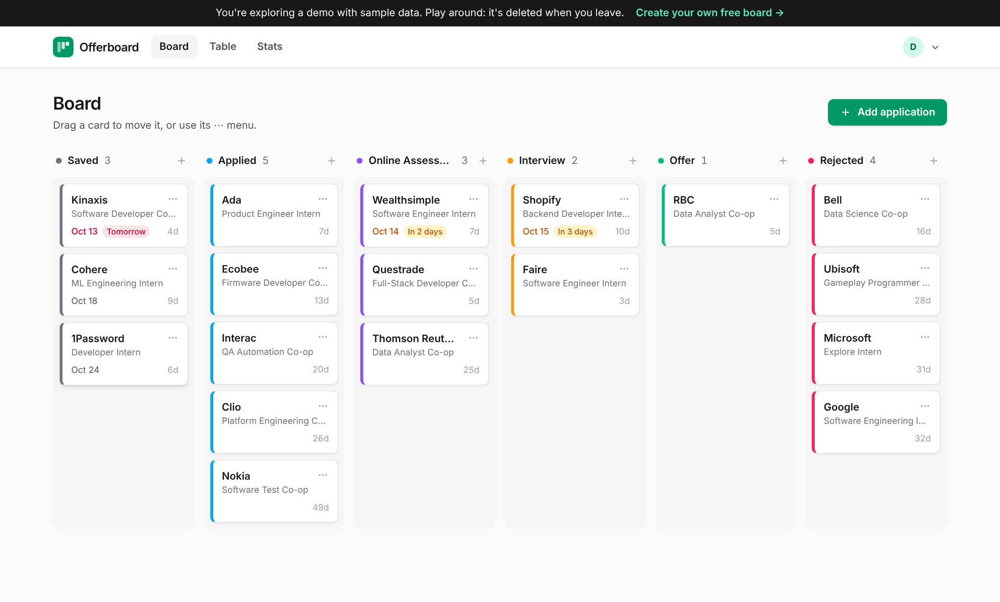
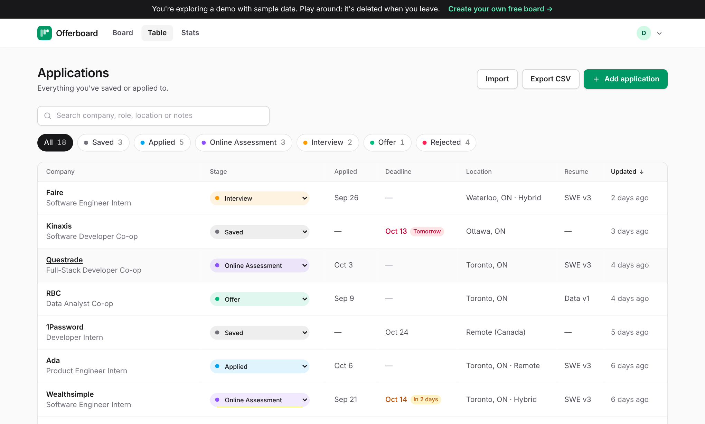
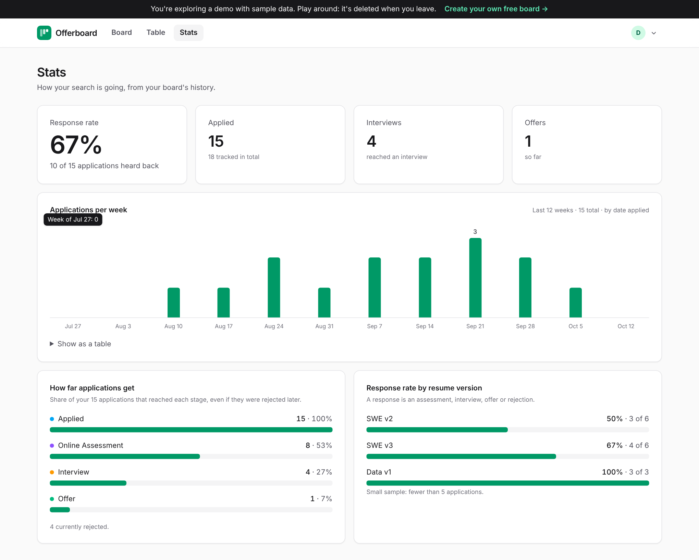
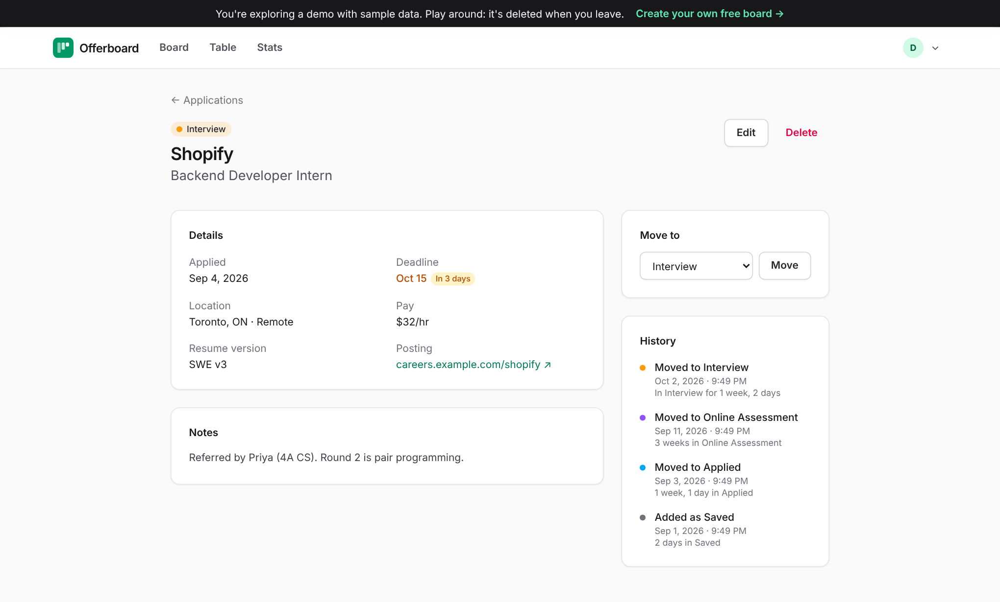
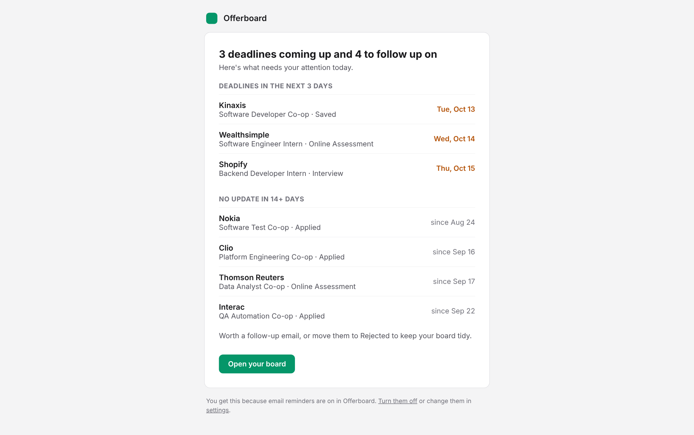
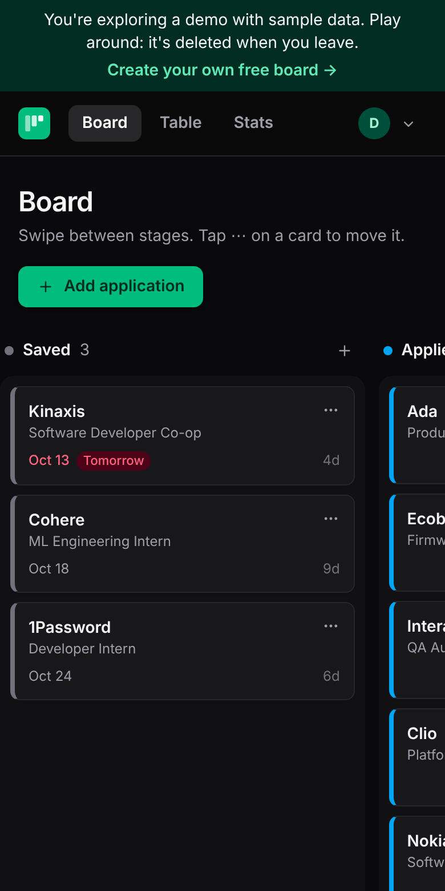
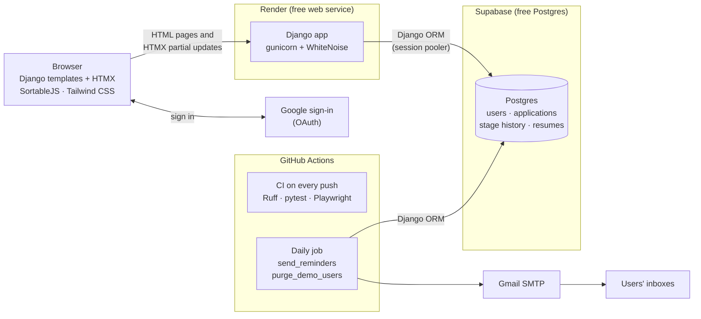

# Offerboard

[](https://github.com/saeedbeingsaeed/offerboard/actions/workflows/ci.yml)

**Track co-op and internship applications on one board.** Move each job from Saved to Offer,
keep deadlines and notes in one place, get a morning email about what's due, and see what's
actually working in your search.

**[Try the live demo →](https://offerboard.onrender.com)** One click, no sign-up: you get your own board filled with sample data.
(It runs on a free server that sleeps when idle, so the first load can take up to a minute.)



## Features

- **Board.** Six stages: Saved, Applied, Online Assessment, Interview, Offer, Rejected. Drag cards between them, or
  use each card's Move menu with the keyboard. Moves save in the background; if a save fails, the card
  goes back and you're told why.
- **Table.** Search, filter by stage, sort by any column, change a stage inline. Works on a phone.
- **History.** Every stage change is recorded with a timestamp; each application shows how long it spent in each stage.
- **Reminders.** A daily email with deadlines in the next 3 days and applications with no update in 2 weeks.
  One click to turn off.
- **Stats.** Applications per week, response rate, how far applications get, and response rate per resume version.
- **CSV import and export.** Import validates every row first and saves nothing if any row is wrong.
- **Demo mode.** A "Try the demo" button that opens a fully working board with sample data, isolated from real users.
- Email/password and Google sign-in. Light and dark mode. Keyboard accessible.

| Table | Stats |
|---|---|
|  |  |

| Application page | Reminder email | Phone, dark mode |
|---|---|---|
|  |  |  |

## Architecture



**Why it's shaped like this**

- **Server-rendered, with HTMX for the interactive parts.** Every page is plain Django templates. Search, filters,
  inline stage changes and board refreshes swap in HTML fragments from the server, so there's no frontend
  framework and no JavaScript build. The only build step is the Tailwind standalone binary.
- **Scheduled work runs in GitHub Actions, not on the web server.** Render's free tier sleeps when idle
  and blocks outgoing email, so a daily workflow runs the reminder and cleanup commands against the same
  database. That daily database access also stops Supabase's free project from pausing.
- **Everything runs on free tiers with no credit card:** Render, Supabase, GitHub Actions, Gmail, Google sign-in.

## How it works

**Per-user data, enforced in one place.** Every model a user owns has an `OwnedQuerySet` manager with a
`for_user(user)` method, and every view that reads user data gets its queryset through `OwnedObjectMixin`
([`tracker/scoping.py`](tracker/scoping.py)). Views never filter by user themselves, so asking for someone
else's application is simply a 404. Sign-in is required by default (`LoginRequiredMiddleware`); public pages
opt out explicitly. [`tests/test_isolation.py`](tests/test_isolation.py) tries to view, edit, move and delete
another user's data through every route.

**Stage history can't be skipped.** `Application.save()` notices when the stage changed and writes a
`StageChange` row in the same transaction ([`tracker/models.py`](tracker/models.py)). The form, drag and drop,
the keyboard menu and CSV import all go through it.

**Stats are SQL aggregations.** Each application is annotated with facts from its history (`Exists` for
"applied" and "got a response", a `Subquery` for the furthest stage reached), then counted with filtered
`Count`s and `TruncWeek`. The whole stats page is three queries ([`tracker/stats.py`](tracker/stats.py)).

**No N+1 queries.** `select_related`/`prefetch_related` where pages show related data, and tests that assert
a fixed query count however much data there is (board, table, detail, stats, reminders, demo).

**Demo mode can't touch real data.** Each "Try the demo" click creates a separate, password-less user flagged
`is_demo` and fills it with sample data ([`accounts/demo.py`](accounts/demo.py)). The same per-user scoping
that separates two real users separates demo and real data. Demo users are deleted when they sign out, are
never emailed, aren't counted in metrics, and are purged after 24 hours by the daily job.

**Reminders are safe to re-run.** The job records the day each user was emailed, so a retried run doesn't
email anyone twice. One failing address doesn't stop the rest, and the run fails visibly if any email failed.
Unsubscribe links are signed tokens that work without signing in.

**Security.** CSRF protection on every state-changing request, including HTMX (the token is sent as a header
from `hx-headers`) and drag and drop. In production: `DEBUG` off by default, secrets from environment variables,
HTTPS redirect, HSTS, secure cookies, `ALLOWED_HOSTS` set. CSV export neutralises spreadsheet formulas.

## Tech stack

Python 3.12+ · Django 6.1 · django-allauth · HTMX · SortableJS · Tailwind CSS 4 (standalone CLI) · Postgres on
Supabase · gunicorn + WhiteNoise on Render · pytest, pytest-django, Playwright · Ruff · GitHub Actions

## Run it locally

Needs Python 3.12+ and `curl`. No Node.js; `bin/tailwind` downloads the Tailwind binary for your machine.

```bash
git clone https://github.com/saeedbeingsaeed/offerboard.git && cd offerboard
python -m venv .venv
source .venv/bin/activate                 # Windows: .venv\Scripts\activate
pip install -r requirements-dev.txt
cp .env.example .env                      # the defaults work as-is: SQLite, DEBUG on, emails printed to the terminal

python manage.py migrate
bin/tailwind -i assets/app.css -o static/dist/app.css    # add --watch while editing templates
python manage.py runserver
```

Open <http://localhost:8000> and click **Try the demo**, or sign up.
`python manage.py createsuperuser` gives you `/admin/` and the `/metrics/` page.

Useful commands:

```bash
python manage.py send_reminders --dry-run    # who would get an email today
python manage.py purge_demo_users            # delete demo accounts older than 24 hours
```

## Tests

```bash
pytest                                # unit and integration tests
playwright install chromium           # once
pytest -m e2e                         # end-to-end: a real browser signs up, adds, drags and reviews
ruff check . && ruff format --check .
```

CI runs linting, the test suite on Python 3.12 and 3.13 against Postgres, Django's production deploy checks,
and the end-to-end test in Chromium on every push.

## Deploy

Step-by-step setup for Supabase, Render, Google sign-in and the reminder emails is in
[**docs/setup.md**](docs/setup.md). Roughly: create a Supabase project, deploy `render.yaml` as a Render Blueprint
with the database URL, add a Google OAuth client, then add the Gmail app password and database URL as GitHub
Actions secrets.

## Project layout

```
config/            settings (one file, configured by environment variables), URLs
accounts/          custom User, demo mode, settings page, unsubscribe, admin metrics
tracker/           applications: models, per-user scoping, views, forms, stats, CSV, reminders
templates/         pages and HTMX partials; allauth pages restyled
assets/app.css     Tailwind source → static/dist/app.css
static/js/         app.js (toasts, menus) and board.js (drag and drop)
tests/             pytest suite; tests/e2e/ for the Playwright test
.github/workflows/ ci.yml (every push) and reminders.yml (daily)
docs/setup.md      deployment guide
```

## Known limits of the free setup

- The Render service sleeps after 15 minutes idle; the next visit waits for it to wake (about 30–60 seconds).
- Render's free tier blocks outgoing email, so the website can't send password-reset emails. The reset page says
  so, and points Gmail users to Google sign-in. Reminder emails are unaffected (they're sent from GitHub Actions).
- Gmail allows about 500 emails a day, plenty for a class, not for thousands of users.
